# analisis-control-plane.md
# Completa este archivo con tus respuestas a los TODOs de la Fase 1.

## TODO 1: Análisis del Plano de Control

> Entorno: clúster Kind `dapr-lab` (Kubernetes v1.36.1, 1 nodo) con Dapr 1.19.0 instalado vía Helm, sin modo HA.

### 1. ¿Qué tipo de objeto de Kubernetes es el `dapr-sidecar-injector`?

El `dapr-sidecar-injector` son en realidad **dos objetos distintos que trabajan juntos**:

1. **Un `Deployment`** (`deployment.apps/dapr-sidecar-injector`, 1/1 réplicas). El `describe` del pod lo confirma con `Controlled By: ReplicaSet/dapr-sidecar-injector-76d4cb6cf4`. Es un servidor HTTPS normal (imagen `ghcr.io/dapr/injector:1.19.0`) que escucha en el puerto `4000/TCP (https)` y lleva en su configuración la imagen que va a inyectar: `SIDECAR_IMAGE=ghcr.io/dapr/daprd:1.19.0`.
2. **Un `MutatingWebhookConfiguration`** (`admissionregistration.k8s.io/v1`, también llamado `dapr-sidecar-injector`), que es lo que registra a ese servidor ante el api-server. Sus datos clave:

| Campo | Valor | Significado |
|---|---|---|
| `rules` | `CREATE` sobre `pods` (`apiGroups: ""`, `v1`) | Solo intercepta la creación de pods |
| `clientConfig.service` | `dapr-sidecar-injector.dapr-system:443/mutate` | A dónde el api-server envía el `AdmissionReview` (el Service redirige al puerto 4000 del pod) |
| `caBundle` | certificado en base64 | Con él el api-server confía en el TLS del injector |
| `namespaceSelector` / `objectSelector` | `{}` | No filtra: **todos** los pods del clúster pasan por el webhook; el injector decide internamente según la anotación `dapr.io/enabled` |
| `failurePolicy` | `Ignore` | Si el injector está caído, el pod se crea igual, pero **sin sidecar** |
| `timeoutSeconds` | `10` | Tiempo máximo que el api-server espera la respuesta |
| `sideEffects` | `None` | El webhook no modifica nada fuera del propio objeto |
| `reinvocationPolicy` | `IfNeeded` | Puede re-invocarse si otro webhook mutante cambia el pod después |

**¿Por qué necesita ser *Mutating* y no *Validating*?** Porque su trabajo es **modificar** el pod antes de que se guarde en etcd: le agrega el contenedor `daprd`, sus puertos, variables de entorno, volúmenes (token de identidad, trust bundle) y probes. Un `ValidatingWebhookConfiguration` solo puede **aceptar o rechazar** un objeto, no cambiarlo. Además, la lista de contenedores de un pod es inmutable una vez creado, así que la única oportunidad de agregar el sidecar es durante la fase de *admission* de la creación.

### 2. Réplicas del `dapr-operator` y comparación con Istio

Está corriendo **1 réplica** del `dapr-operator` (`deployment.apps/dapr-operator 1/1`). Es la configuración por defecto sin alta disponibilidad; con `--set global.ha.enabled=true` se desplegarían 3.

El plano de control completo quedó en 7 pods: `dapr-operator`, `dapr-sentry`, `dapr-sidecar-injector` (Deployments), `dapr-placement-server` (StatefulSet, 1) y `dapr-scheduler-server` (StatefulSet, 3).

**¿Por qué es más liviano que el de Istio?**

- **No está en el camino del tráfico ni calcula ruteo.** `istiod` debe calcular y empujar continuamente configuración xDS (rutas, clusters, endpoints, políticas) a **cada** proxy Envoy, y ese trabajo crece con el número de servicios y endpoints de la malla. El plano de control de Dapr solo distribuye objetos declarativos (`Component`, `Configuration`, `Subscription`, `Resiliency`) a los sidecars y emite certificados; el descubrimiento de servicios lo resuelve el propio `daprd` usando el DNS de Kubernetes.
- **Sidecar explícito, no transparente.** Istio intercepta todo el tráfico del pod con reglas iptables (vía init container o CNI) y un Envoy con muchísima funcionalidad L4/L7. En Dapr la app llama **explícitamente** al sidecar en `localhost` (HTTP 3500 / gRPC 50001); no hay redirección de tráfico ni reglas de red que gestionar.
- **Menos CRDs y menos superficie.** Istio define muchos recursos de tráfico y seguridad (VirtualService, DestinationRule, Gateway, PeerAuthentication, etc.). Dapr instala pocos CRDs enfocados en configurar *building blocks*.
- **Componentes pequeños y separados por responsabilidad**: la imagen del injector, por ejemplo, pesa ~15 MB (`Image size: 15391033 bytes`).

### 3. Flujo de inyección del sidecar

Desde `kubectl apply` de un Deployment con `dapr.io/enabled: "true"` hasta que el sidecar corre:

1. **`kubectl apply`** envía el Deployment al **api-server**, que autentica, autoriza y lo guarda en etcd. El Deployment en sí **no** pasa por el webhook (la regla es solo para `pods`).
2. El **Deployment controller** crea un **ReplicaSet**, y el **ReplicaSet controller** crea los objetos **Pod** a partir del `spec.template`. Por eso la anotación debe ir en `spec.template.metadata.annotations` y no en la metadata del Deployment.
3. Al recibir el `CREATE` del Pod, el api-server entra en la fase de **mutating admission**: la regla `CREATE pods` coincide (y los selectores `{}` no excluyen nada), así que envía un `AdmissionReview` por HTTPS a `dapr-sidecar-injector.dapr-system:443/mutate`, validando el certificado con el `caBundle`, con un timeout de 10 s.
4. El **injector** revisa las anotaciones del pod:
   - Si no tiene `dapr.io/enabled: "true"`, responde sin cambios.
   - Si la tiene, construye un **JSON Patch** que agrega el contenedor `daprd` (`ghcr.io/dapr/daprd:1.19.0`) con: su `app-id` y `app-port` (de las anotaciones `dapr.io/app-id`, `dapr.io/app-port`), las direcciones del plano de control (`dapr-sentry…:443`, `dapr-placement-server:50005`, scheduler, operator), los puertos 3500/50001/9090, volúmenes para el token de identidad y el trust bundle, y probes de salud.
5. El api-server **aplica el patch**, ejecuta los demás webhooks (reinvocando si hace falta, `IfNeeded`), luego la validación, y **persiste el Pod ya mutado** en etcd con dos contenedores.
6. El **kube-scheduler** asigna el pod a un nodo y el **kubelet** descarga las imágenes y arranca el contenedor de la app y el contenedor `daprd`.
7. Al arrancar, **`daprd`**:
   - presenta su token de ServiceAccount a **`dapr-sentry`** y recibe su certificado mTLS (identidad SPIFFE);
   - se conecta al **`dapr-operator`** para obtener los `Component`, `Configuration` y `Subscription` de su namespace;
   - se registra con **placement** y **scheduler**;
   - empieza a escuchar en `localhost:3500` (HTTP) y `:50001` (gRPC).

   Cuando sus probes pasan, el pod se ve como **`2/2 Running`**.

**Caso de falla:** como `failurePolicy: Ignore`, si el injector no está disponible el pod se crea **sin sidecar** y sin error visible (queda `1/1`). Como el webhook solo actúa en `CREATE`, para corregirlo hay que recrear los pods (por ejemplo, `kubectl rollout restart deployment/<nombre>`).

---

## TODO 2: Exploración de los CRDs de Dapr

### 4. CRDs instalados por Dapr

Dapr 1.19.0 instaló **7 CRDs**, todos del grupo `dapr.io` y todos **namespaced** (`kubectl api-resources --api-group=dapr.io`):

| CRD | Kind | Versión | Para qué sirve |
|---|---|---|---|
| `components.dapr.io` | `Component` | `v1alpha1` | Declara **qué tecnología concreta** implementa un building block (Redis, Kafka, PostgreSQL…). Campos obligatorios: `type`, `version`, `metadata`; opcionales: `initTimeout`, `ignoreErrors`. Con `scopes` se limita a ciertos `app-id`. |
| `configurations.dapr.io` | `Configuration` | `v1alpha1` | Ajustes de comportamiento del sidecar: tracing, métricas, mTLS, control de acceso, middlewares y feature flags. Un pod la usa con la anotación `dapr.io/config`. |
| `subscriptions.dapr.io` | `Subscription` | `v2alpha1` | Suscripción **declarativa** de Pub/Sub: qué app (`scopes`) recibe qué `topic` de qué `pubsubname` y en qué ruta HTTP, sin escribir código de suscripción. |
| `resiliencies.dapr.io` | `Resiliency` | `v1alpha1` | Políticas de **timeouts, reintentos y circuit breakers** aplicadas a llamadas entre apps, a componentes y a actores. |
| `httpendpoints.dapr.io` | `HTTPEndpoint` | `v1alpha1` | Registra un servicio HTTP **externo** (sin sidecar Dapr) para poder invocarlo con la API de service invocation como si fuera una app más. |
| `mcpservers.dapr.io` | `MCPServer` | `v1alpha1` | *(Nuevo en esta versión)* Declara una conexión a un servidor **MCP (Model Context Protocol)** para ejecución durable de herramientas. Campos: `endpoint` (obligatorio: transporte y destino), `catalog` (metadatos de gobierno, solo informativos), `middleware` (hooks de workflow alrededor de cada llamada a herramienta) e `ignoreErrors`. |
| `workflowaccesspolicies.dapr.io` | `WorkflowAccessPolicy` | `v1alpha1` | *(Nuevo en esta versión)* Define, mediante `rules`, una **allow-list** de qué llamadores pueden realizar qué operaciones sobre workflows. |

Observación: casi todos están en versión `alpha`; `Subscription` ya va en `v2alpha1`, lo que muestra que su esquema evolucionó (v2 agrega ruteo por reglas).

### 5. Relación entre `components.dapr.io` y el concepto de Building Block

- El **Building Block** es la **abstracción**: una API estable que expone el sidecar, por ejemplo `POST /v1.0/publish/{pubsub}/{topic}` para Pub/Sub o `/v1.0/state/{store}` para State. La aplicación solo conoce esa API.
- El **Component** es la **implementación concreta** (el "enchufe"): dice *qué tecnología* hay detrás de esa API y *cómo conectarse* a ella.
- El **CRD** `components.dapr.io` es el **tipo de recurso** de Kubernetes que permite declarar esos componentes como YAML; cada objeto `Component` es una instancia.

El vínculo está en el campo obligatorio `spec.type`, cuyo formato es `<building-block>.<tecnología>`:

```yaml
apiVersion: dapr.io/v1alpha1
kind: Component
metadata:
  name: pubsub          # nombre que usa la app en la URL: /v1.0/publish/pubsub/...
spec:
  type: pubsub.redis    # building block = pubsub, implementación = redis
  version: v1
  metadata:
  - name: redisHost
    value: redis-master:6379
```

Por lo tanto, **el componente es la implementación concreta, no la abstracción**. Esto permite cambiar Redis por Kafka modificando solo el YAML (`type: pubsub.kafka` y su `metadata`) sin tocar el código, siempre que se mantenga el mismo `metadata.name`. El `dapr-operator` observa estos objetos y los entrega a los sidecars `daprd` del namespace, que cargan el driver correspondiente al iniciar.

---

## Evidencias

Capturas de la ejecución paso a paso de la Fase 1.

### Prerrequisitos

Versiones instaladas: Docker 29.7.2, kind v0.32.0, kubectl v1.36.1, Helm v4.2.4.

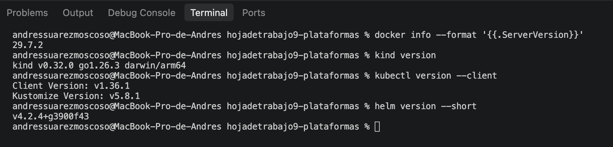

### Creación del clúster Kind

`kind create cluster --name dapr-lab`: contexto `kind-dapr-lab`, nodo `dapr-lab-control-plane` en `Ready` (Kubernetes v1.36.1).

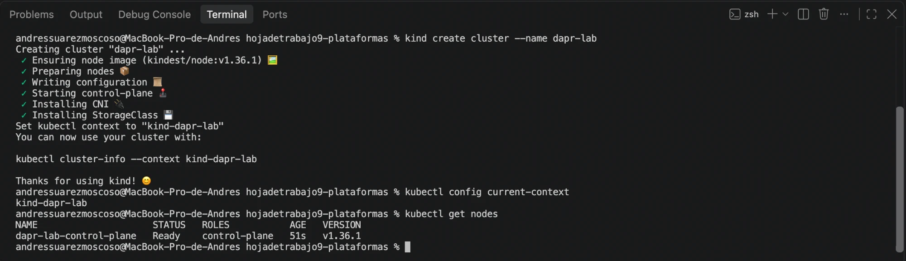

### Instalación de Dapr con Helm

Chart `dapr/dapr` 1.19.0. El dashboard aparece como chart separado (`dapr/dapr-dashboard`).

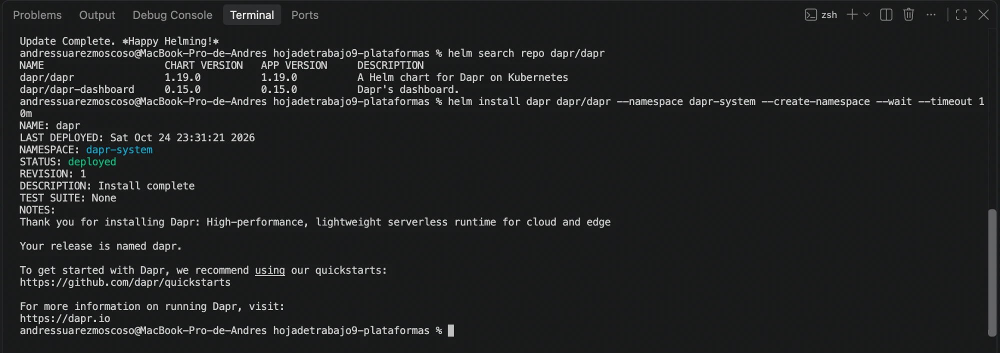

### Pods del plano de control, webhook y CRDs

7 pods en `Running` (no existe `dapr-sentinels`; el componente real es `dapr-sentry`, y aparece `dapr-scheduler-server`), el `MutatingWebhookConfiguration` `dapr-sidecar-injector` y 7 CRDs.

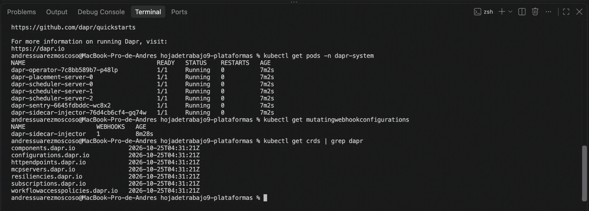

### Tipos de objeto y réplicas (preguntas 1 y 2)

3 Deployments (`dapr-operator` 1/1, `dapr-sentry`, `dapr-sidecar-injector`) y 2 StatefulSets (`dapr-placement-server` 1/1, `dapr-scheduler-server` 3/3).

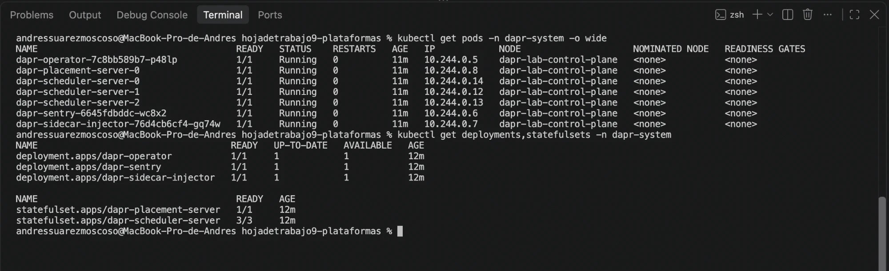

### `describe` del pod `dapr-sidecar-injector`

`Controlled By: ReplicaSet/...`, puerto `4000/TCP (https)`, `SIDECAR_IMAGE: ghcr.io/dapr/daprd:1.19.0`, `DAPR_SENTRY_ADDRESS`, `ACTORS_SERVICE_ADDRESS`, volúmenes de identidad y eventos de arranque.

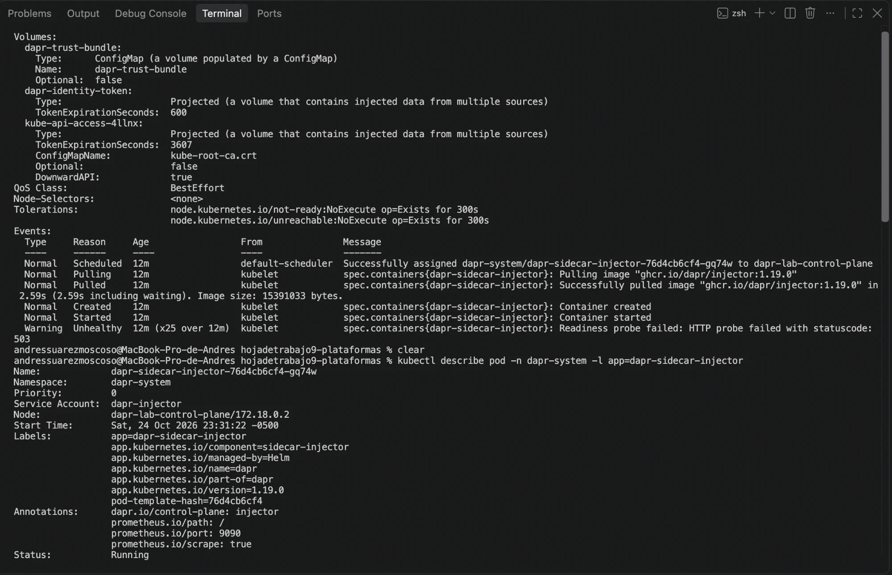

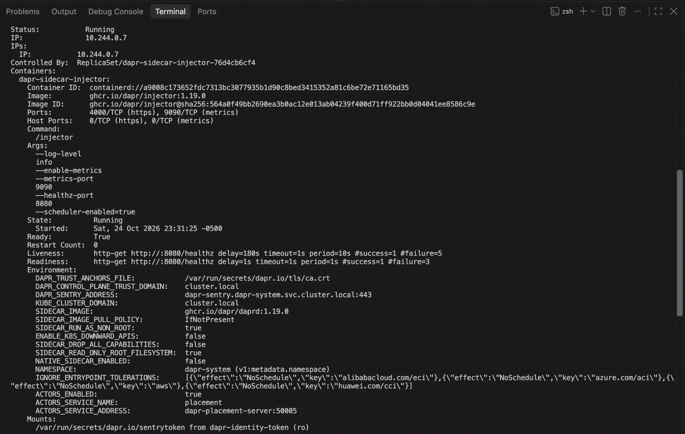

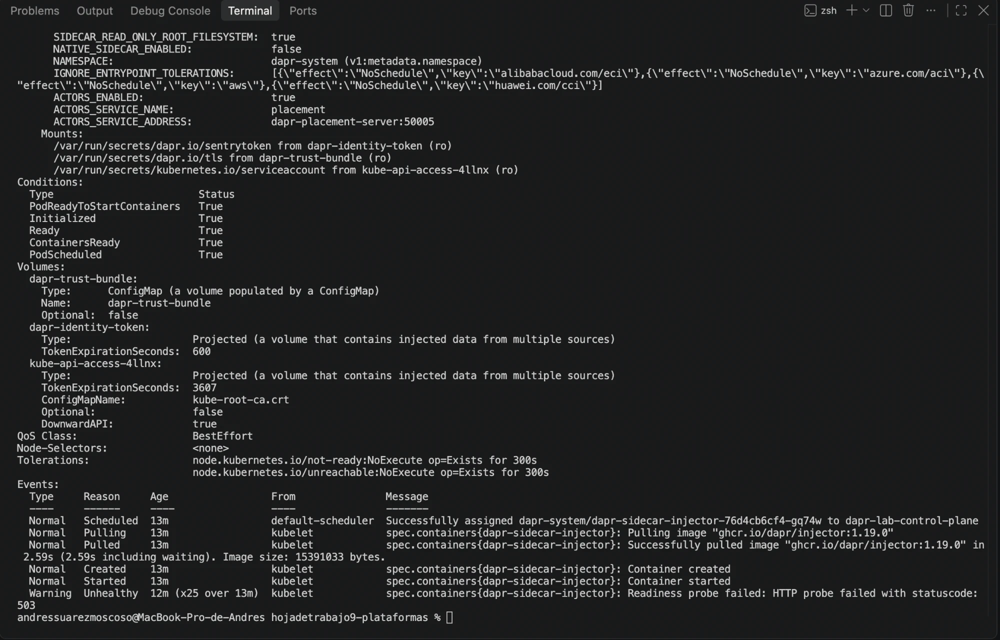

### `MutatingWebhookConfiguration` `dapr-sidecar-injector` (preguntas 1 y 3)

`clientConfig.service` → `dapr-sidecar-injector.dapr-system:443/mutate`, `failurePolicy: Ignore`, `namespaceSelector: {}`, `objectSelector: {}`, `reinvocationPolicy: IfNeeded`, `rules: CREATE pods`, `sideEffects: None`, `timeoutSeconds: 10`.

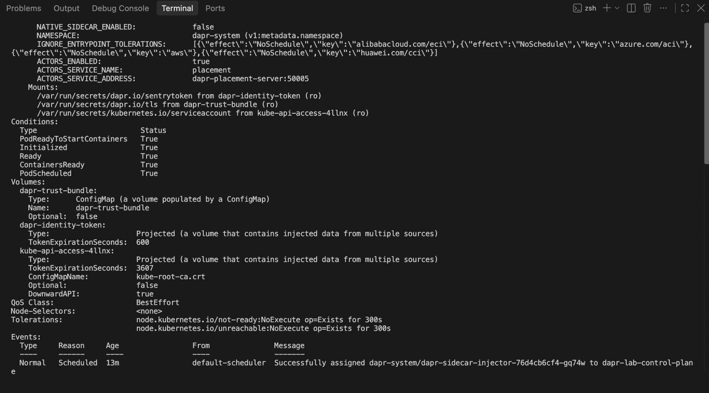

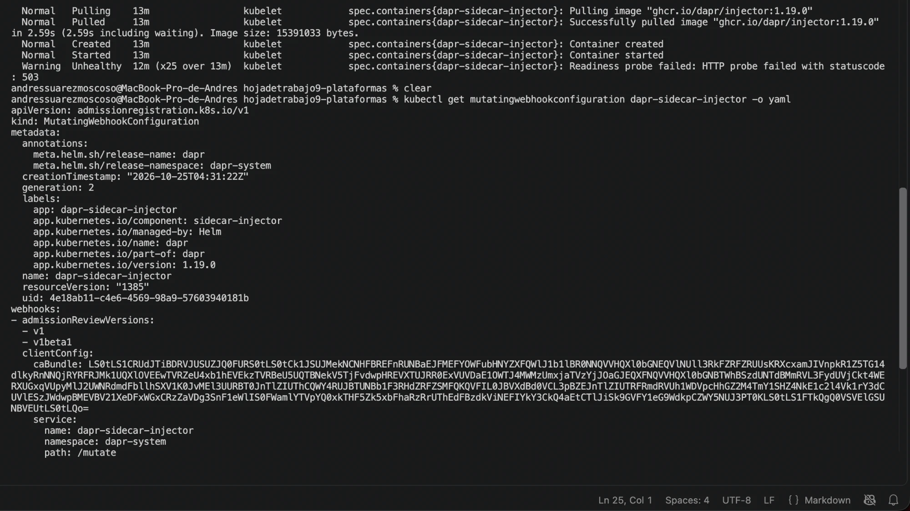

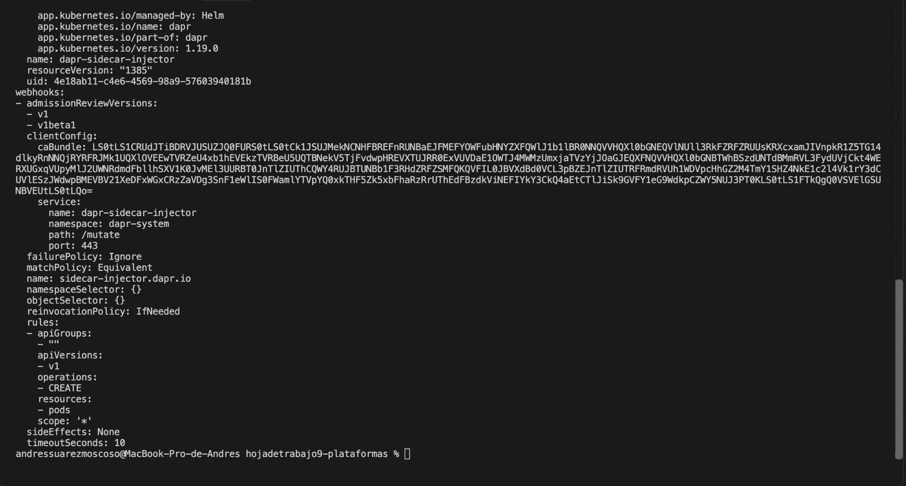

### CRDs de Dapr (preguntas 4 y 5)

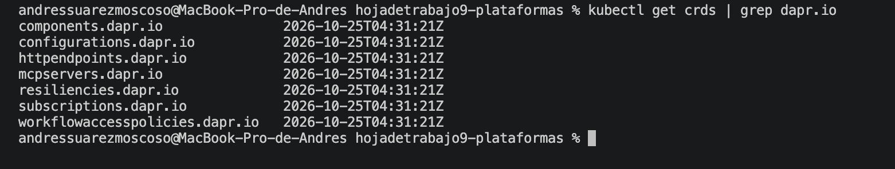

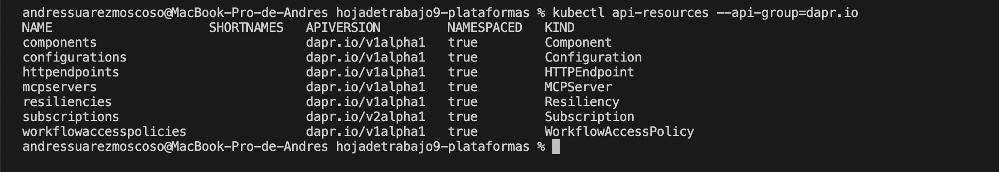

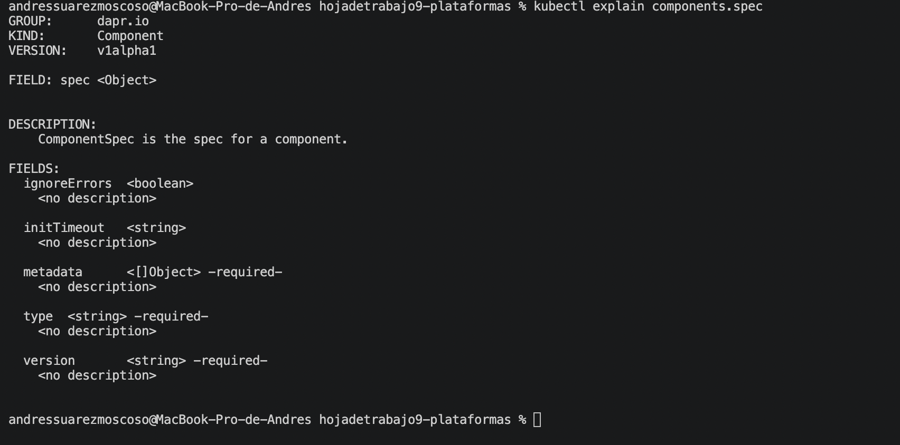

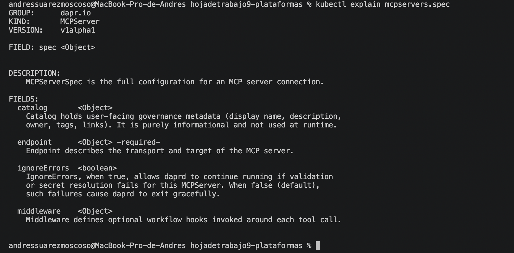

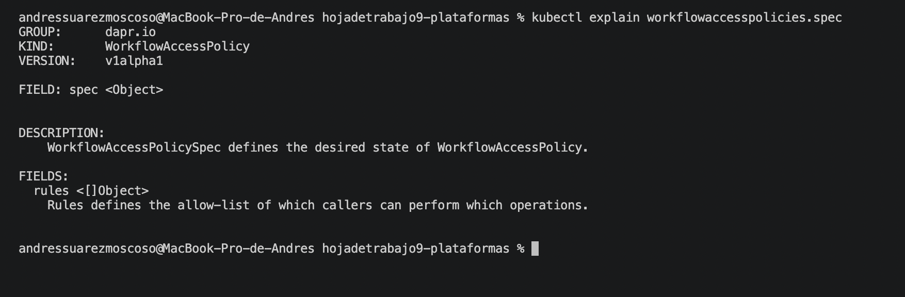

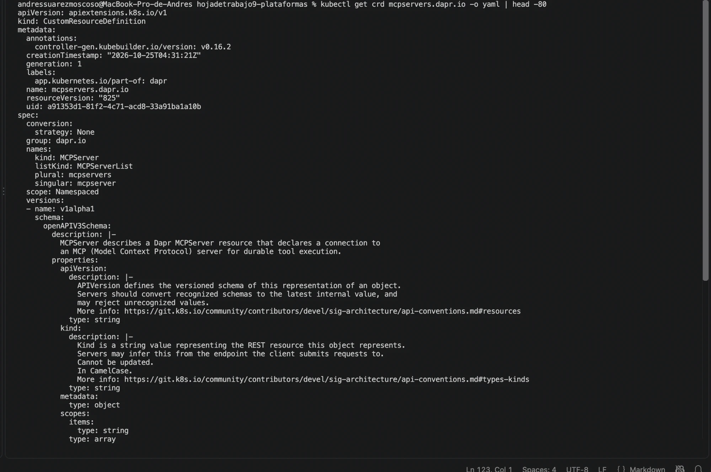

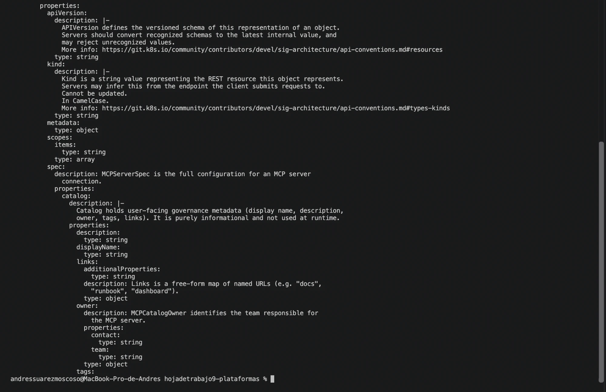
