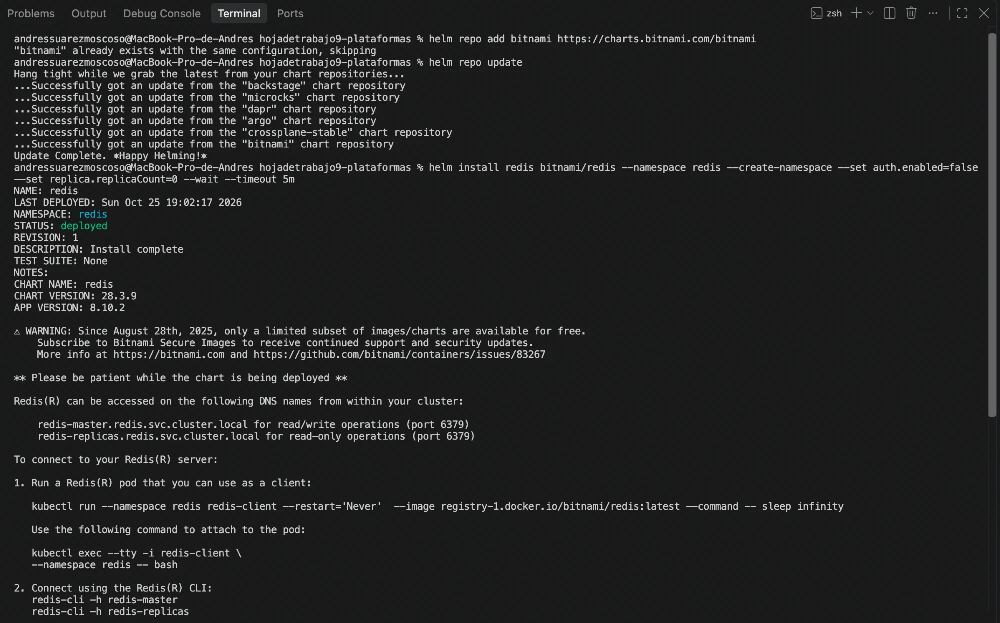
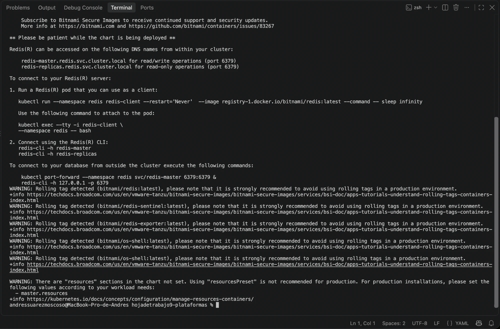
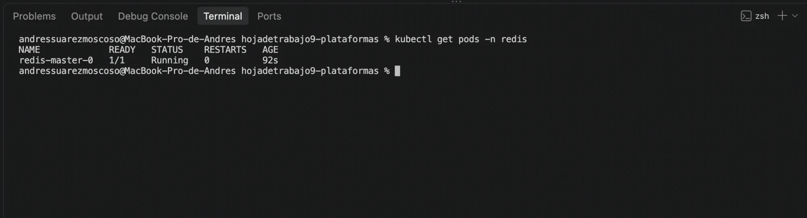
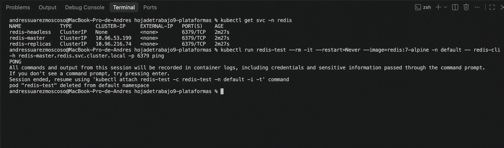
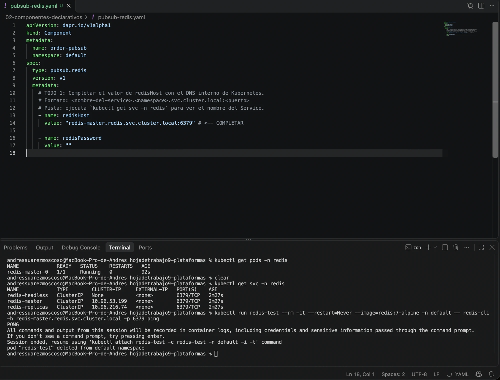
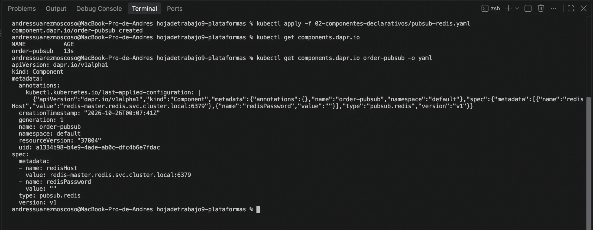
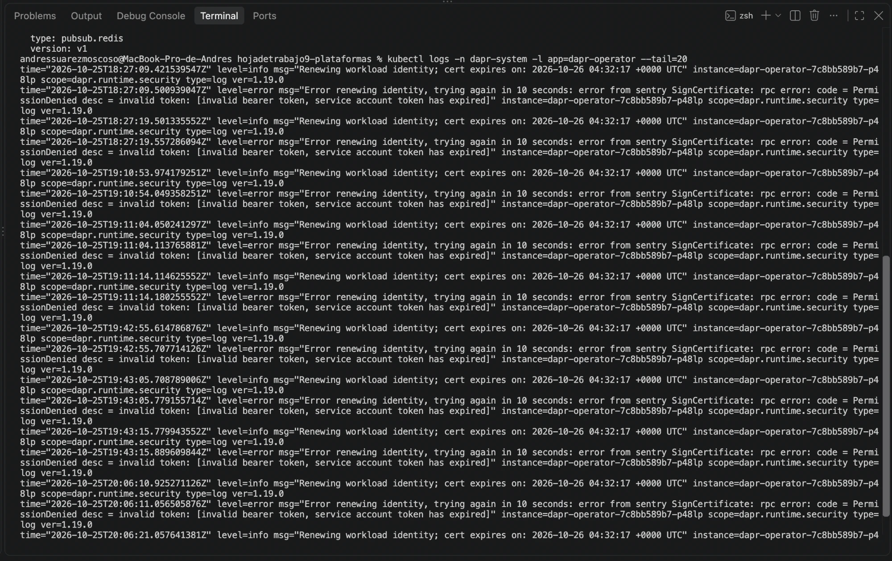
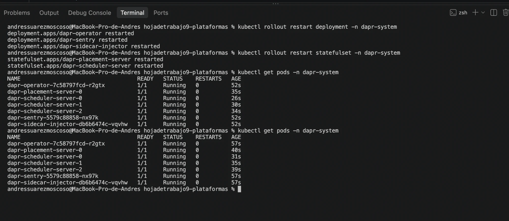
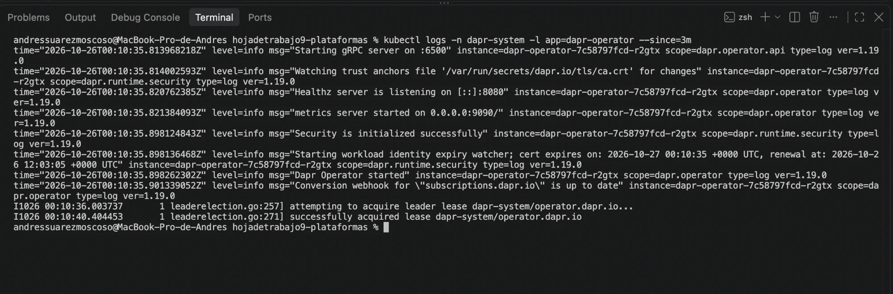

# analisis-abstraccion.md
# Completa este archivo con tus respuestas a los TODOs de la Fase 2.

## TODO 2: Análisis de la Abstracción

### 1. Migración de broker: ¿qué archivos cambiarían?

**Solo cambia la capa de infraestructura; el código Python del publisher y del subscriber no se toca.**

Archivos/artefactos que cambiarían al migrar de Redis a Apache Kafka:

| Qué | Cambio |
|---|---|
| `02-componentes-declarativos/pubsub-redis.yaml` | Se reemplaza (o se crea un `pubsub-kafka.yaml`) con `spec.type: pubsub.kafka` y la `metadata` propia de Kafka (`brokers`, `consumerGroup`, `authType`, etc.). **Se conserva `metadata.name: order-pubsub`.** |
| Instalación del broker | En lugar de `helm install redis bitnami/redis` se instala Kafka (por ejemplo, con el operador Strimzi o un chart de Kafka). |

Lo que **no** cambia:

- **El código de las apps**: publican con `POST http://localhost:3500/v1.0/publish/order-pubsub/<topic>` (o el SDK equivalente) y reciben eventos en una ruta HTTP. Ambos solo conocen el **nombre lógico** `order-pubsub` y el topic, nunca la palabra "Redis" ni "Kafka".
- **Los Deployments y sus anotaciones** (`dapr.io/enabled`, `dapr.io/app-id`, ...).
- **Las suscripciones declarativas** (`Subscription`), porque referencian `pubsubname: order-pubsub`.
- **El formato del mensaje**: el sidecar sigue envolviendo los eventos en CloudEvents 1.0.

La clave es mantener el mismo `metadata.name`. Si se cambiara el nombre del componente, sí habría que tocar el código o la configuración que lo referencia.

Matices a considerar en una migración real:

- Los mensajes que quedaron pendientes en Redis **no se migran solos**; hay que drenar el broker viejo antes del cambio.
- Ciertas características dependen del broker (orden por partición en Kafka, TTL, *dead-letter topics*). Si la app usa metadatos específicos al publicar (por ejemplo, `partitionKey`), hay que revisar que el nuevo broker los soporte.
- Como el sidecar carga los componentes al arrancar, tras aplicar el nuevo YAML hay que reiniciar los pods (`kubectl rollout restart`).

### 2. Inventario de 5 brokers soportados por Dapr

| Broker | `spec.type` en el YAML |
|---|---|
| Redis Streams | `pubsub.redis` |
| Apache Kafka | `pubsub.kafka` |
| RabbitMQ | `pubsub.rabbitmq` |
| Azure Service Bus (Topics) | `pubsub.azure.servicebus.topics` |
| AWS SNS/SQS | `pubsub.aws.snssqs` |

Otros soportados: GCP Pub/Sub (`pubsub.gcp.pubsub`), NATS JetStream (`pubsub.jetstream`), Apache Pulsar (`pubsub.pulsar`), MQTT (`pubsub.mqtt3`) y uno en memoria para pruebas (`pubsub.in-memory`).

**Campo que cambia:** `spec.type`, con el formato `pubsub.<implementación>`, junto con la lista `spec.metadata`, cuyas claves dependen de cada broker (por ejemplo, `redisHost` en Redis o `brokers` en Kafka). `apiVersion`, `kind` y `metadata.name` se mantienen iguales.

### 3. Manejo seguro de secretos en producción

Dapr ofrece el building block **Secrets**, implementado con componentes **Secret Store** (`secretstores.*`). En lugar de escribir el valor en el YAML, el componente usa **`secretKeyRef`** para referenciar un secreto almacenado en un secret store:

```yaml
apiVersion: dapr.io/v1alpha1
kind: Component
metadata:
  name: order-pubsub
  namespace: default
spec:
  type: pubsub.redis
  version: v1
  metadata:
    - name: redisHost
      value: "redis-master.redis.svc.cluster.local:6379"
    - name: redisPassword
      secretKeyRef:
        name: redis-secret      # nombre del secreto
        key: redis-password     # clave dentro del secreto
auth:
  secretStore: kubernetes       # en Kubernetes es el valor por defecto y puede omitirse
```

En Kubernetes, Dapr trae integrado el secret store `kubernetes`, que lee `Secrets` nativos del clúster. Así, el YAML que vive en Git solo contiene la **referencia**, no la contraseña. El sidecar resuelve el valor en tiempo de ejecución.

Para producción se suele usar un gestor externo, declarado como otro `Component`:

| Secret Store | `spec.type` |
|---|---|
| HashiCorp Vault | `secretstores.hashicorp.vault` |
| Azure Key Vault | `secretstores.azure.keyvault` |
| AWS Secrets Manager | `secretstores.aws.secretmanager` |
| GCP Secret Manager | `secretstores.gcp.secretmanager` |
| Kubernetes Secrets | `secretstores.kubernetes` (integrado) |

Buenas prácticas complementarias:

- **No versionar el `Secret` de Kubernetes en texto plano** (base64 no es cifrado). Se crea fuera de Git o se gestiona con herramientas como External Secrets Operator, Sealed Secrets o SOPS.
- **Limitar el acceso**: con la sección `secrets.scopes` de un `Configuration` se restringe qué secretos puede leer cada app (`allowedSecrets` / `deniedSecrets`), y con `scopes` en el componente qué `app-id` pueden usarlo.
- Las apps también pueden leer secretos en tiempo de ejecución mediante la API `GET /v1.0/secrets/<store>/<key>`, sin manejar credenciales del gestor.

---

## Evidencias

Capturas de la ejecución paso a paso de la Fase 2.

### Instalación de Redis (Bitnami)

Chart `bitnami/redis` 28.3.9 (Redis 8.10.2). Las `NOTES` indican el DNS `redis-master.redis.svc.cluster.local` (puerto 6379).







### TODO 1: descubrir el Service y validar el DNS

Services `redis-headless`, `redis-master` (10.96.53.199) y `redis-replicas`. Desde el namespace `default`, `redis-cli -h redis-master.redis.svc.cluster.local ping` responde `PONG`.





### Aplicación del componente `order-pubsub`

`component.dapr.io/order-pubsub created` y el objeto guardado en el clúster con `spec.type: pubsub.redis` y el `redisHost` completado.



### Incidente: token de ServiceAccount expirado tras suspender la Mac

El `dapr-operator` no podía renovar su certificado mTLS con `dapr-sentry` (`service account token has expired`). Se resolvió reiniciando el plano de control; el operator volvió con `Security is initialized successfully` y un certificado nuevo.






