# analisis-cloudevents.md
# Completa este archivo con tus respuestas al TODO 4 de la Fase 3.

> Entorno: Kind `dapr-lab`, Dapr 1.19.0, componente `order-pubsub` (`pubsub.redis`).
> Se ejecutó el publisher dos veces: la primera sin tracing y la segunda con una `Configuration` de Dapr (`tracing.samplingRate: "1"`) referenciada con la anotación `dapr.io/config: "tracing"` en el publisher.

Evidencia (logs del subscriber, segunda ejecución):

```
id          : 0a9bcd05-b614-4764-9f8c-ef7e93fe6a08
source      : order-publisher
type        : com.dapr.event.sent
traceparent : 00-cd887dea870655f8e354d670a65752f0-616b513c81e8aee5-01
data        : {'orderId': '1001', 'status': 'created'}
```

## TODO 4: Análisis de Trazabilidad (CloudEvents)

### 1. El atributo `id`: ¿quién lo genera y para qué sirve?

Lo genera el **sidecar `daprd` del publisher** en el momento de publicar: es un UUID v4 que Dapr asigna al construir el sobre CloudEvents. El código Python del publisher solo envió `{"orderId": ..., "status": ...}`; nunca generó un `id`.

**Importancia para la idempotencia:** Dapr Pub/Sub ofrece entrega **at-least-once**: si el subscriber no responde `200` (o responde `RETRY`, o hay un timeout), el sidecar vuelve a entregar el **mismo** mensaje con el **mismo** `id`. Por lo tanto el subscriber puede:

- guardar los `id` ya procesados (en una tabla o en un state store), y
- ignorar un evento cuyo `id` ya existe,

para que un reintento no procese dos veces la misma orden (por ejemplo, cobrar dos veces).

En el lab se ve la diferencia entre *reentrega* y *nueva publicación*: al ejecutar el Job dos veces, la orden `1001` llegó con dos `id` distintos (`3d717029-…` y `0a9bcd05-…`), porque fueron **dos publicaciones distintas**. El `id` identifica el **evento**, no la entidad de negocio; por eso la deduplicación debe basarse en el `id` del CloudEvent (o en una clave de negocio si se quiere evitar también publicaciones duplicadas).

### 2. El atributo `source`: ¿qué valor tiene y de dónde lo toma Dapr?

Su valor es **`order-publisher`**. Dapr lo toma del **`app-id` del publisher**, que se declara con la anotación `dapr.io/app-id: "order-publisher"` en `publisher-job.yaml`. El sidecar conoce su propio `app-id` desde que fue inyectado, y lo escribe en `source` al envolver cada mensaje.

Así, el consumidor sabe **qué servicio originó el evento** sin que el publisher tenga que incluirlo en su payload, y el valor no puede ser "olvidado" o alterado por el código de negocio.

### 3. El atributo `traceparent` y su relación con OpenTelemetry

`traceparent` implementa el estándar **W3C Trace Context**. Su formato es `versión-traceId-parentId-flags`:

| Parte | Valor observado | Significado |
|---|---|---|
| versión | `00` | Versión del formato W3C |
| trace-id | `cd887dea870655f8e354d670a65752f0` | 16 bytes (32 hex): identifica la **traza completa** de punta a punta |
| parent-id | `616b513c81e8aee5` | 8 bytes (16 hex): identifica el **span** que originó el mensaje (la publicación en el sidecar del publisher) |
| flags | `01` | `sampled`: esta traza se está registrando |

**Relación con OpenTelemetry:** W3C Trace Context es el formato de propagación por defecto de OpenTelemetry. Dapr instrumenta sus sidecars con OpenTelemetry: crea un span al publicar, guarda el contexto en el CloudEvent (`traceparent`), y el sidecar del subscriber lo lee para crear un span **hijo** con el mismo trace-id y reenviarlo a la app como header HTTP `traceparent`. Esos spans se exportan (vía OTLP, Zipkin, etc.) a backends como Jaeger, Grafana Tempo o Zipkin, donde la traza publisher → broker → subscriber se ve como un solo flujo, aunque haya pasado por Redis de forma asíncrona.

Observación del lab: en la **primera ejecución `traceparent` llegó vacío**, porque no había tracing configurado. Al crear la `Configuration` con `samplingRate: "1"` y referenciarla con `dapr.io/config`, el sidecar empezó a generar contexto. Además, cada orden tuvo un **trace-id distinto**, porque el publisher no recibió una petición con traza previa: cada `POST /v1.0/publish` inició una traza nueva. Si el publisher fuera, por ejemplo, una API que recibe un `traceparent` del cliente, el evento continuaría esa misma traza.

### 4. Valor de negocio para auditoría: atributos más útiles del sobre CloudEvents

El subscriber del lab solo imprime algunos campos, así que se leyó el sobre **completo** directamente desde el stream de Redis (`kubectl exec -n redis redis-master-0 -- redis-cli XREVRANGE orders + - COUNT 1`):

```json
{
  "data": {"orderId": "1003", "status": "shipped"},
  "datacontenttype": "application/json",
  "id": "e4e027e3-a783-4241-be29-59905279d8f1",
  "pubsubname": "order-pubsub",
  "source": "order-publisher",
  "specversion": "1.0",
  "time": "2026-10-26T00:34:15Z",
  "topic": "orders",
  "traceid": "00-21378ece7c7ab0562e34c1be8811f1d4-c985d5e44eaf4a83-01",
  "traceparent": "00-21378ece7c7ab0562e34c1be8811f1d4-c985d5e44eaf4a83-01",
  "tracestate": "",
  "type": "com.dapr.event.sent"
}
```

Esto confirma que el publisher solo aportó `data`; **todo lo demás lo agregó el sidecar**. También muestra que Redis almacena el CloudEvent tal cual, con el ID de entrada del stream (`1792974855955-0`), que es un timestamp en milisegundos.

Para rastrear todos los eventos de las últimas 24 h, los atributos más útiles serían:

| Atributo | Por qué sirve en auditoría |
|---|---|
| `id` | Identificador único de cada evento: permite contarlos, deduplicarlos y referenciar un evento específico en un hallazgo |
| `time` | Marca de tiempo (RFC 3339) que Dapr agrega al publicar: es el filtro natural para "las últimas 24 h" y permite ordenar cronológicamente |
| `source` | **Quién** emitió el evento (`app-id`); responde "¿qué servicio generó esta orden?" |
| `type` | **Qué clase** de evento es; permite filtrar por tipo de operación (en producción conviene publicar tipos de negocio, p. ej. `com.empresa.orden.creada`, en vez del genérico `com.dapr.event.sent`) |
| `topic` / `pubsubname` | Extensiones de Dapr: **por dónde** viajó el evento (canal y broker lógico) |
| `traceparent` / `traceid` | (en el sobre observado, `traceid` y `traceparent` tienen el mismo valor). Permiten saltar del registro de auditoría a la **traza completa** en Jaeger/Tempo y ver todos los servicios que tocaron esa operación, con tiempos y errores |
| `data` | El contenido de negocio (`orderId`, `status`) para reconstruir el historial de cada orden |

La ventaja clave es que estos metadatos son **uniformes y automáticos**: todos los servicios con sidecar Dapr producen el mismo sobre, sin que cada equipo implemente su propio formato de auditoría. Basta con persistir los eventos (por ejemplo, un subscriber de auditoría suscrito a los topics, o una consulta al broker) e indexarlos por `time`, `source`, `type` y `id`.

---

## Evidencias

Capturas de la ejecución paso a paso de la Fase 3.

### Construcción y carga de imágenes en Kind

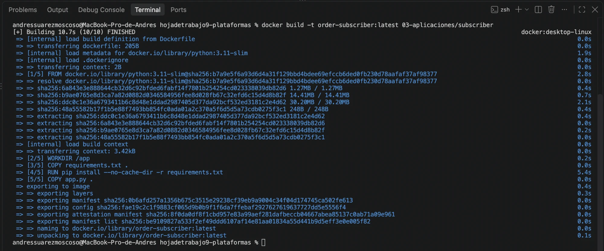

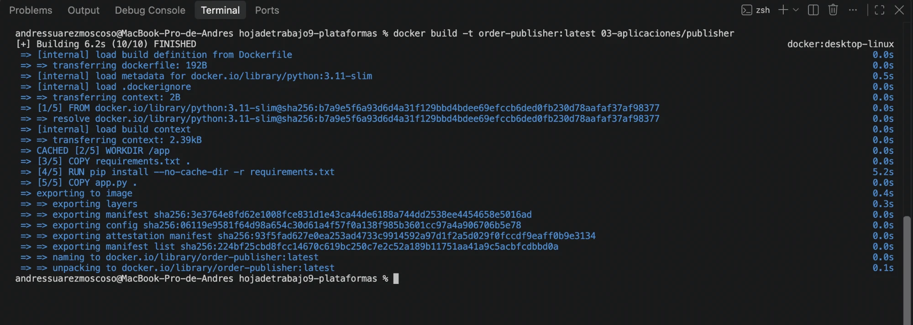

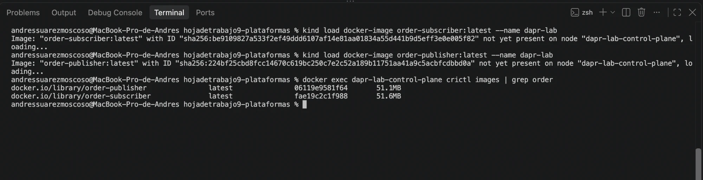

### Despliegue del subscriber con sidecar

Pod `order-subscriber` en `2/2`, contenedores `order-subscriber daprd`. Los logs de `daprd` muestran `application discovered on port 5001` y `app is subscribed to the following topics: [[orders]] through pubsub=order-pubsub`.

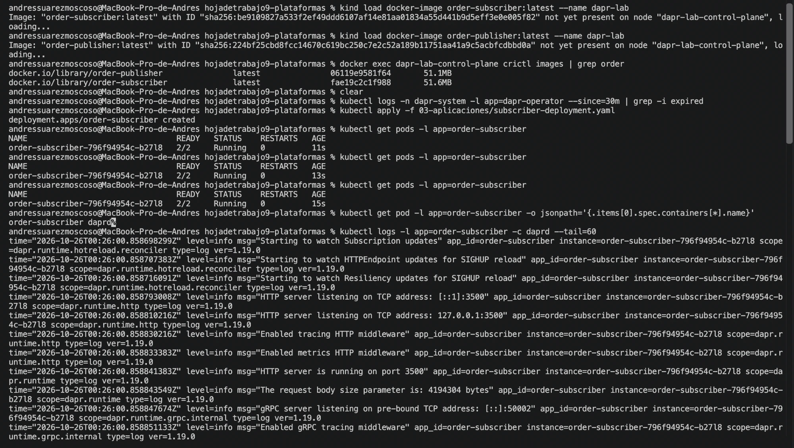

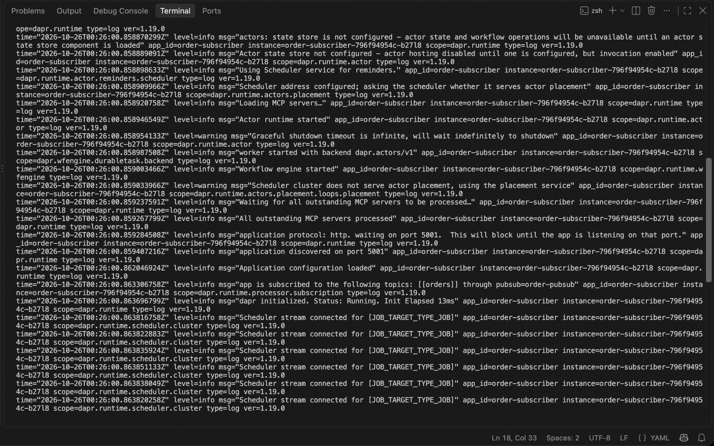

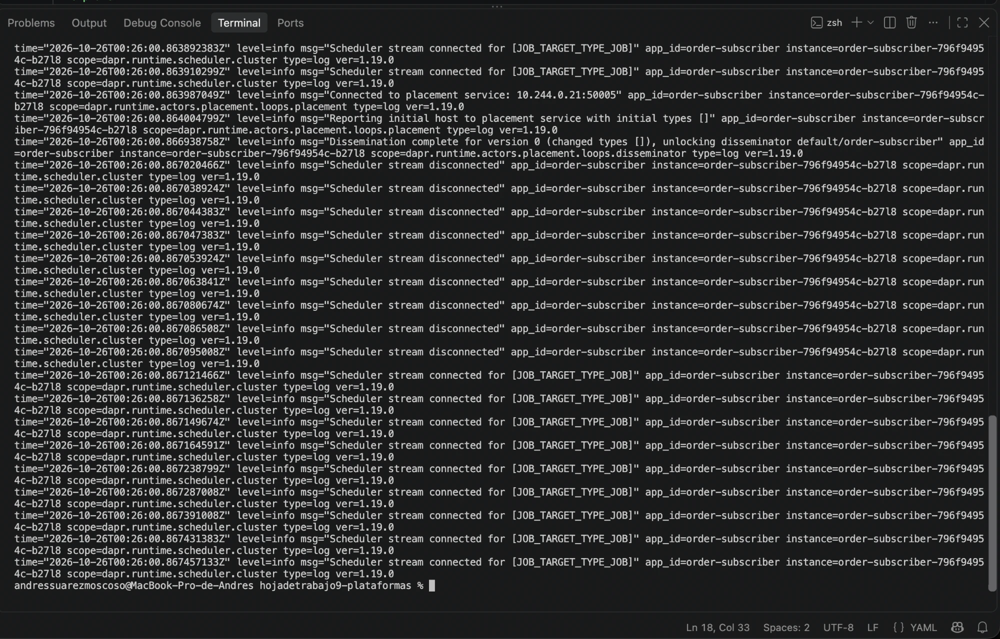

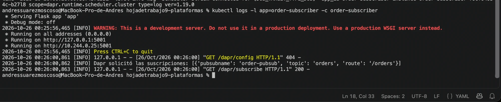

### Publicación y recepción de CloudEvents (sin tracing)

Consumer group `order-subscriber` en Redis y los 3 CloudEvents recibidos con `id`, `source: order-publisher`, `type: com.dapr.event.sent` y `traceparent` vacío.

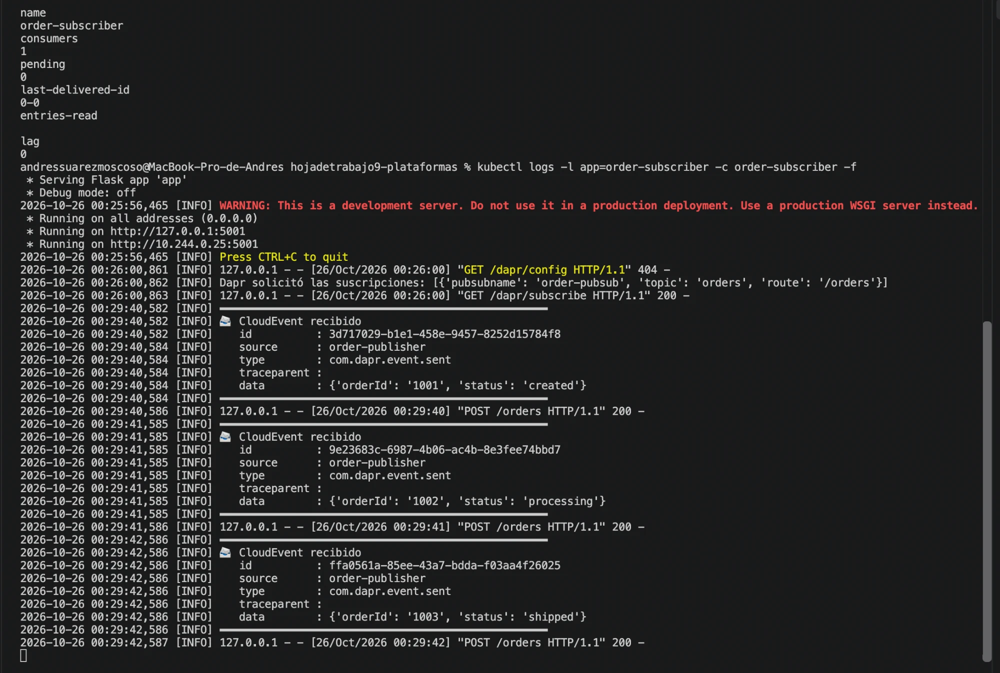

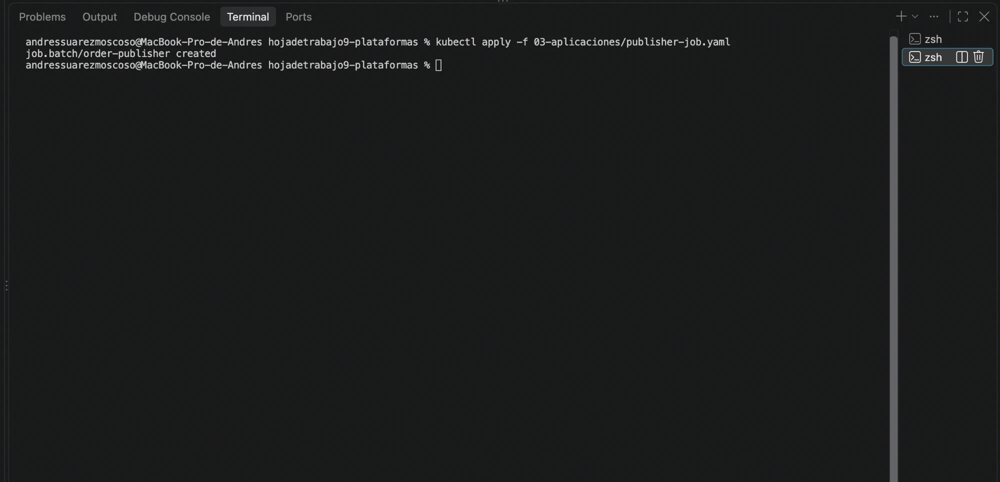

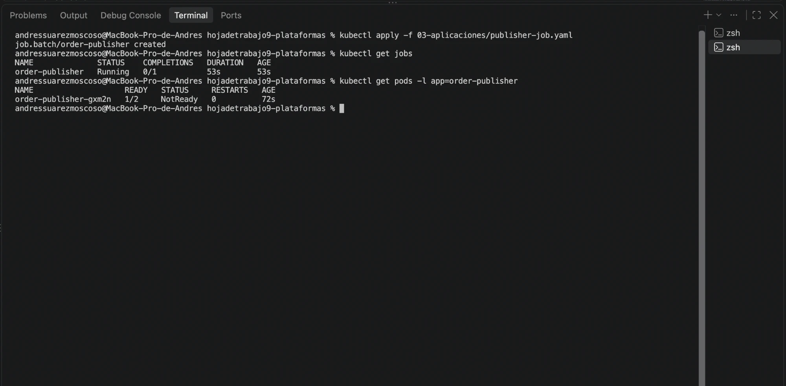

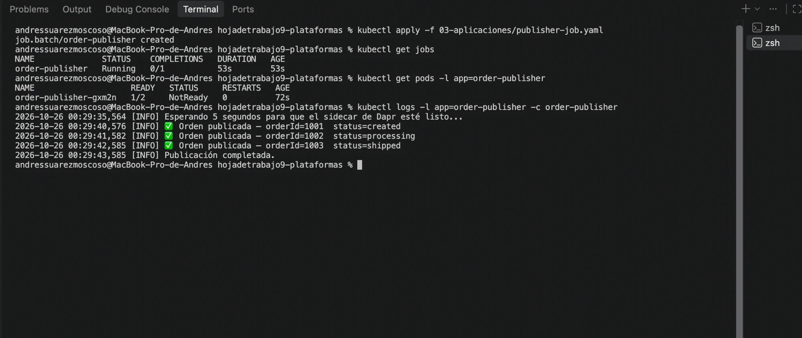

### Con tracing activado (`Configuration` `tracing`, `samplingRate: "1"`)

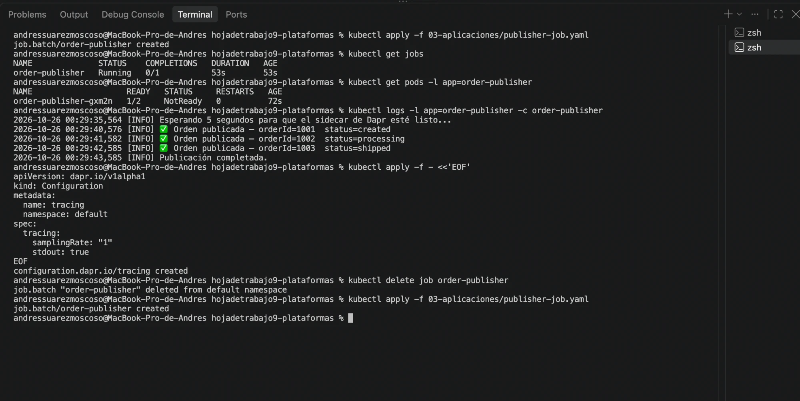

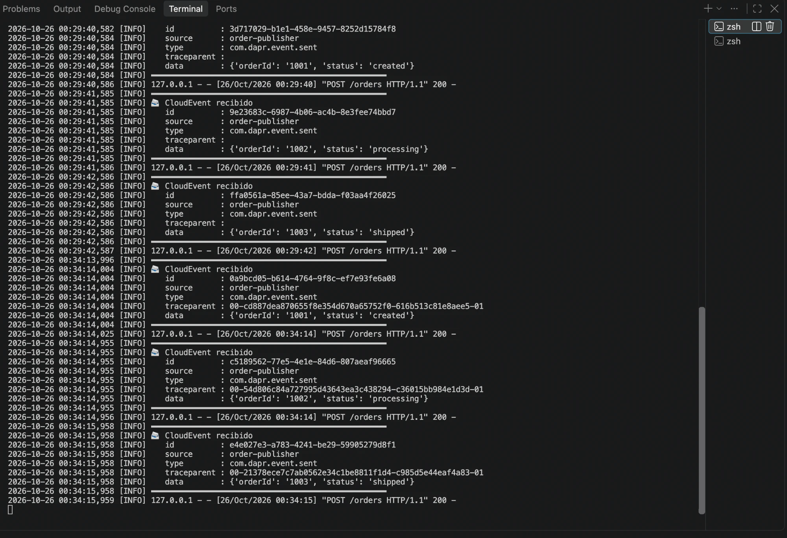

### Sobre CloudEvents completo leído desde Redis (pregunta 4)

`XREVRANGE orders + - COUNT 1`: muestra `time`, `topic`, `pubsubname`, `traceid`, `tracestate`, `specversion` y `datacontenttype`, que el subscriber no imprime.

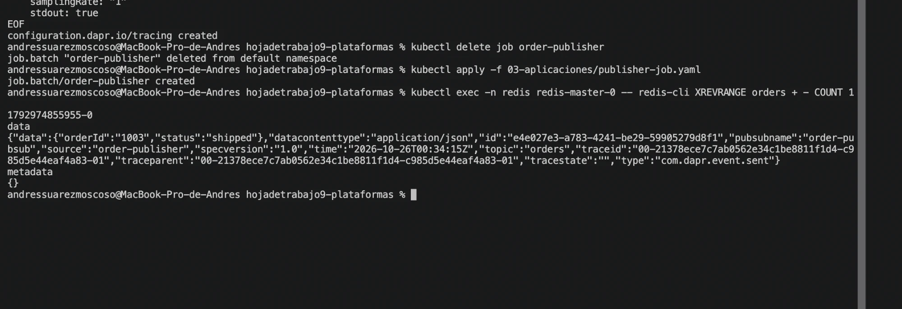
