# reflexion-arquitectonica.md
# Completa este archivo con tus respuestas al Reto 3 de la Fase 4.

> Entorno: Kind `dapr-lab`, Dapr 1.19.0, Redis (Bitnami, Redis 8) como broker.
> Componente aplicado: `order-pubsub` con `ttlInSeconds: "120"` y `consumerID: "{namespace}"`.

## Evidencia experimental de los retos 1 y 2

### Reto 2: `consumerID: "{namespace}"`

Con `redis-cli MONITOR` se observaron los comandos que el sidecar envía a Redis al suscribirse:

```
"xgroup" "create" "defaultorders" "default.order-subscriber" "0" "mkstream"
"xreadgroup" "group" "default.order-subscriber" "default.order-subscriber" "count" "100" "block" "0" "streams" "defaultorders" ">"
```

- `{namespace}` se resolvió como **`<namespace>.<appId>`** → consumer group `default.order-subscriber` (antes era `order-subscriber`).
- Además, Dapr **antepuso el namespace al nombre del topic**: el stream físico pasó de `orders` a **`defaultorders`**. El aislamiento entre namespaces no es solo de consumer group, sino de **topic**.
- Efecto colateral: los 6 mensajes de la Fase 3 quedaron en el stream `orders`, que ya nadie consume.

### Reto 1: TTL

| Prueba | Resultado |
|---|---|
| `ttlInSeconds: "120"` en el **Component** (prueba del README: subscriber en 0, publicar, esperar >130 s, subscriber en 1) | Los mensajes se guardaron en Redis **sin** atributo `expiration` (`metadata {}`) y **los 3 llegaron** al subscriber ~145 s después de publicarse. **No hubo descarte.** |
| TTL **por mensaje** (`POST /v1.0/publish/order-pubsub/orders?metadata.ttlInSeconds=30`) | El mensaje 2001 se guardó con `"expiration":"2026-10-26T01:10:30Z"` (= `time` + 30 s). Al encender el subscriber después de esa hora, `daprd` registró `dropping expired pub/sub event b05a7cfb-… as of 2026-10-26T01:10:30Z` y la app **solo recibió** el mensaje de control 2002 (sin TTL). |

Conclusión: en Redis, el TTL de Dapr es **por mensaje**: lo define quien publica, el sidecar del publisher lo escribe como `expiration` en el CloudEvent y el **sidecar del subscriber** descarta el mensaje vencido antes de entregarlo. Redis no elimina nada.

Hallazgos adicionales durante el reto:

- Los mensajes acumulados se entregaron **fuera de orden** (1003 → 1002 → 1001).
- Un pod creado directamente con `kubectl run` **no recibió sidecar**: el injector registró `service account 'kubernetes-admin' not on the list of allowed controller accounts`. Dapr solo inyecta en pods creados por controladores (Deployment, Job, …) para evitar que un usuario suplante el `app-id` (y la identidad mTLS) de otro servicio. Como el webhook tiene `failurePolicy: Ignore`, el pod se creó sin error visible.

---

## Reto 3: Reflexión Arquitectónica

### 1. Sin Dapr: ¿dónde vive el código de TTL y consumer group?

Con el SDK de Kafka directamente, ambas cosas viven **dentro de cada aplicación**:

- **Consumer group:** es la propiedad `group.id` de la configuración del consumidor, escrita en el código o en variables de entorno de cada servicio. La convención de nombres (por ejemplo, incluir el equipo o el namespace) depende de que cada equipo la respete manualmente; si dos equipos eligen `order-service`, colisionan.
- **TTL:** Kafka no tiene TTL por mensaje. Lo más cercano es `retention.ms` a nivel de topic, que borra segmentos completos por antigüedad pero **no impide** que un consumidor procese un mensaje viejo que aún no se ha borrado. Para cumplir "las órdenes expiran a los 2 minutos", cada consumidor tendría que leer el timestamp del registro y descartar los que superen 120 s, y cada productor debería fijar ese timestamp de forma consistente.

**Responsable:** el **equipo de la aplicación**, en cada servicio y en cada lenguaje. La misma lógica se reimplementa N veces y deriva con el tiempo (un equipo usa 120 s, otro olvida validar). El equipo de plataforma solo opera el broker y no tiene un punto de control para hacer cumplir las reglas.

Con Dapr, el consumer group pasa al `Component` (`consumerID`), administrado por la plataforma, y el descarte de mensajes vencidos lo hace el sidecar. Pero, según lo observado en el reto 1, **la decisión del TTL sigue en quien publica** (se envía como metadata al publicar), no solo en el YAML.

### 2. El patrón sidecar como frontera de responsabilidad

Separaría **el "qué" (regla de negocio)** del **"cómo" (mecanismo de infraestructura)**:

| Equipo | Responsabilidad |
|---|---|
| **Producto** | Define y es dueño del SLA: "una orden `created` expira a los 120 s". Lo declara como un **parámetro** de su servicio: en un archivo de valores propio (Helm/Kustomize overlay) o, dado que en Redis el TTL es por mensaje, como metadata `ttlInSeconds` en la publicación, idealmente leída de configuración y no fija en el código. |
| **Plataforma** | Es dueña del `Component` (conexión al broker, secretos, `consumerID` con `{namespace}`, `scopes`), de las plantillas y de los **guardarraíles**: valores por defecto, rangos permitidos (por ejemplo, TTL entre 30 s y 24 h) validados con políticas (OPA Gatekeeper / Kyverno), y la retención física del broker (`maxLenApprox`/`streamTTL` en Redis, `retention.ms` en Kafka). |

Cómo se coordinan en la práctica:

- **GitOps con CODEOWNERS:** el equipo de producto propone el cambio del valor de TTL en su overlay; el de plataforma revisa y aprueba los cambios al `Component` base.
- **Contrato del evento documentado** (por ejemplo, AsyncAPI) donde el TTL forma parte del contrato del topic `orders`, visible para productores y consumidores.
- **Observabilidad compartida:** el log `dropping expired pub/sub event` debería convertirse en una métrica/alerta; si se descartan muchos mensajes, el equipo de producto revisa su SLA y el de plataforma la capacidad de los consumidores.

Así, el negocio decide el valor y la plataforma garantiza que se aplique de forma uniforme y segura.

### 3. Limitaciones de la abstracción: ¿migración 100% transparente?

No. La API que usa la aplicación no cambia, pero **la semántica sí depende del broker**. Limitaciones concretas, varias observadas en este laboratorio:

1. **El TTL no se comporta igual en todos los brokers ni en todos los niveles.**
   - Observado: `ttlInSeconds` dentro del `Component` **no tuvo efecto** con Redis; solo funcionó el TTL por mensaje en la publicación.
   - Según la documentación de Dapr, solo Azure Service Bus tiene TTL nativo; para el resto (Redis, Kafka) Dapr lo **emula**: el mensaje **sí llega al broker y al sidecar del subscriber**, que lo descarta. El broker no lo borra (en Redis el stream sigue creciendo), y un consumidor **sin** Dapr recibiría el mensaje vencido y tendría que revisar el atributo `expiration` por su cuenta.
   - En Kafka el TTL "real" es `retention.ms` a nivel de topic, con otra granularidad.
2. **Los consumer groups tienen nombres, campos y comportamientos distintos.**
   - Redis usa `consumerID` como nombre del grupo; Kafka usa `consumerGroup` (que, si se define, hace que `consumerID` se ignore).
   - Observado en Redis: con `{namespace}`, Dapr no solo cambió el grupo (`default.order-subscriber`), sino también el **nombre físico del topic** (`orders` → `defaultorders`). Cambiar esta configuración "migra" silenciosamente a un topic nuevo y deja los mensajes anteriores huérfanos.
   - Posición inicial distinta: en Redis un grupo nuevo se crea leyendo desde el inicio del stream (`XGROUP CREATE ... 0`), mientras que en Kafka `initialOffset` es `newest` por defecto. Tras una migración, un grupo nuevo podría reprocesar todo el historial en un broker y nada en el otro.
3. **Orden de entrega.** Observado: los mensajes acumulados llegaron en orden inverso. Kafka garantiza orden por partición, pero Dapr no expone ese contrato de forma uniforme; si la lógica de negocio depende del orden (created → processing → shipped), la abstracción no lo asegura.
4. **La metadata del componente no es portable.** Al migrar se reescribe `spec.metadata` completo (`redisHost` → `brokers`, autenticación, `consumerGroup`, retención, particiones), y hay que reiniciar los pods para que los sidecars carguen el nuevo componente.

En resumen: Dapr hace portable **el código**, pero no **las garantías** (TTL, orden, posición inicial, aislamiento). Una migración de broker sigue requiriendo revisar y probar esas garantías con evidencia, igual que se hizo en este laboratorio.

---

## Evidencias

Capturas de la ejecución paso a paso de la Fase 4.

### Aplicación del componente del reto y reinicio del subscriber

`component.dapr.io/order-pubsub configured` con `ttlInSeconds=120` y `consumerID={namespace}`. El log con `-l` mezcló el pod nuevo (sin mensajes) con el pod viejo (último evento de la Fase 3).

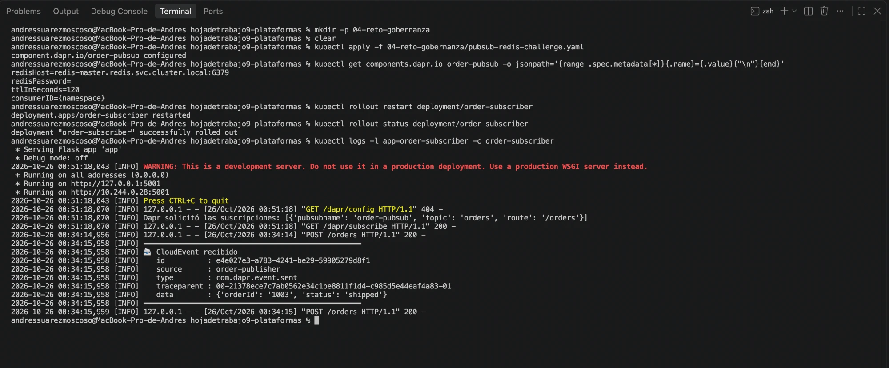

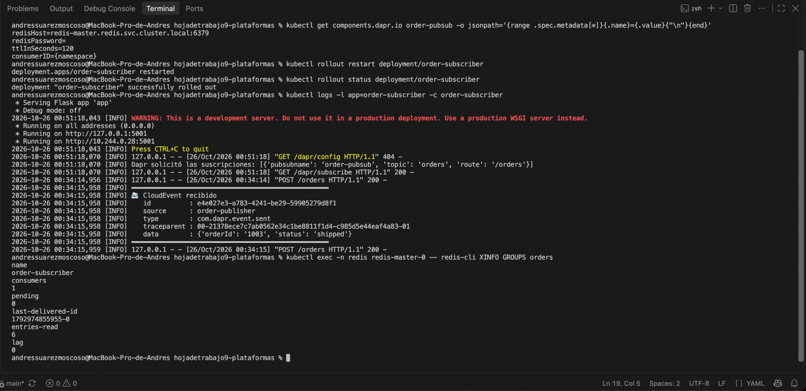

### Diagnóstico del consumer group

`Component loaded: order-pubsub (pubsub.redis/v1)` sin errores; en el stream `orders` solo existía el grupo antiguo.

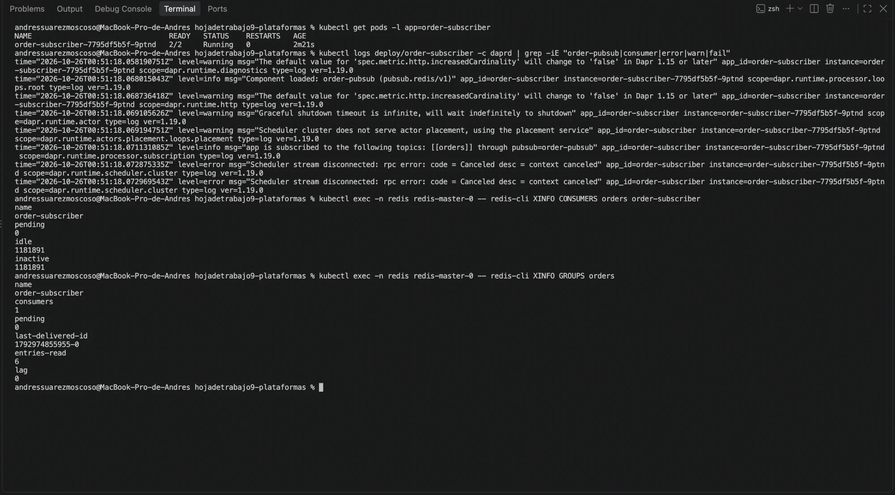

### Reto 2: `redis-cli MONITOR` revela el efecto de `{namespace}`

`xgroup create defaultorders default.order-subscriber 0 mkstream`: el grupo pasa a `<namespace>.<appId>` y el stream a `defaultorders`.

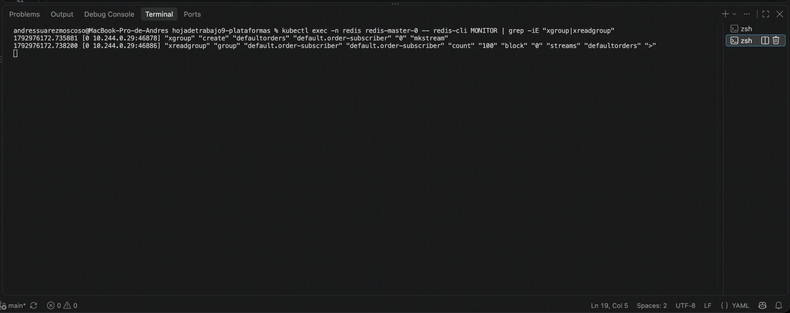

### Reto 1: TTL a nivel de componente (no tuvo efecto)

Mensajes guardados sin `expiration` y con `metadata {}`; tras más de 120 s con el subscriber apagado, los 3 llegaron igual (a las 01:00:32, publicados a las 00:58:05–07) y fuera de orden. `daprd` no registró descartes (solo aparece la expiración del certificado mTLS).

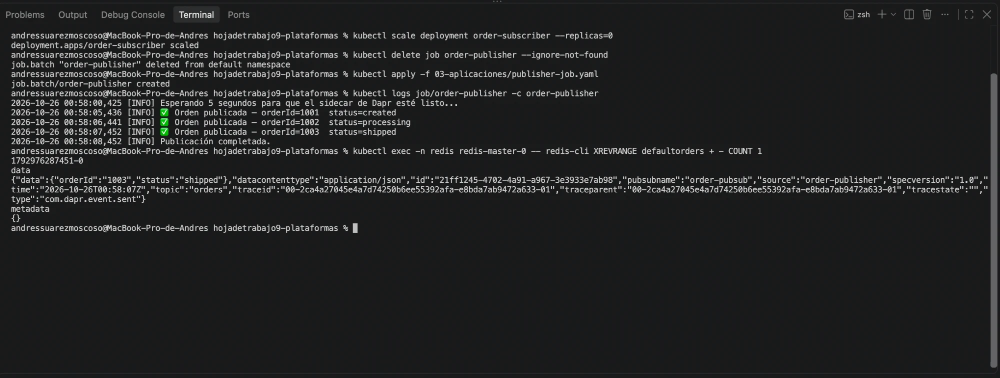

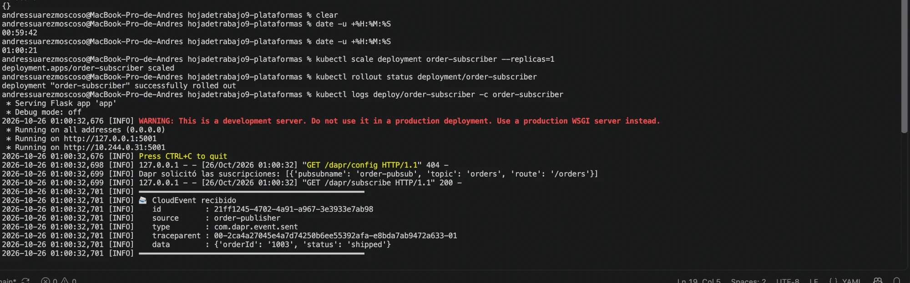

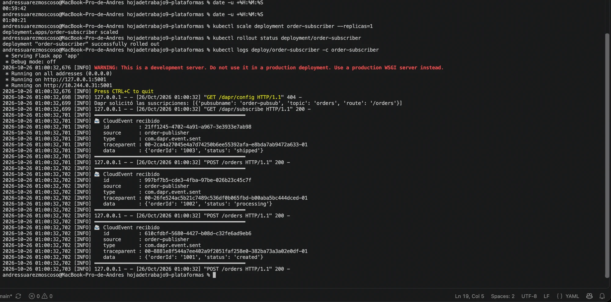

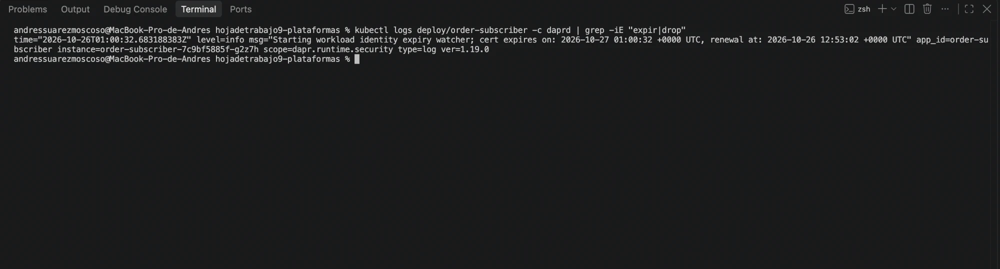

### Hallazgo: un pod creado con `kubectl run` no recibe sidecar

El pod `ttl-tester` quedó `1/1` y los `curl` a `localhost:3500` fallaron (`000`, exit code 7). El injector registró `service account 'kubernetes-admin' not on the list of allowed controller accounts`.

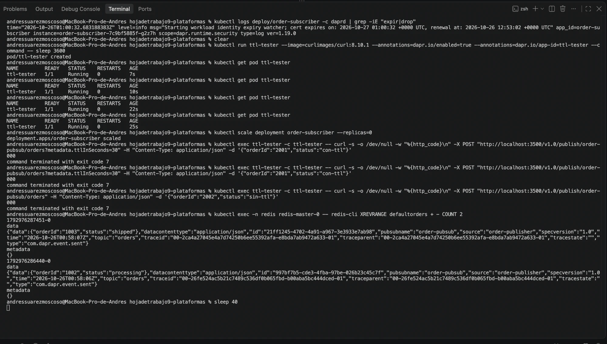

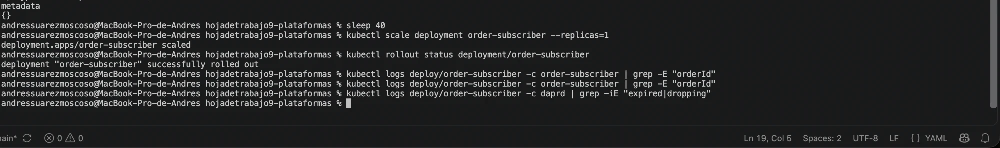

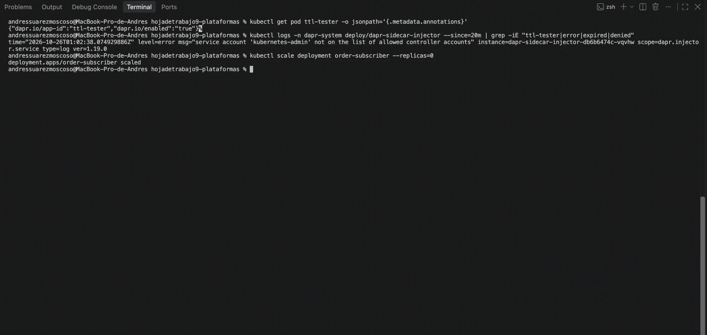

### TTL por mensaje (forma documentada): sí funciona

Con el tester como Deployment (`2/2`), el mensaje 2001 publicado con `?metadata.ttlInSeconds=30` se guardó con `"expiration":"2026-10-26T01:10:30Z"` y `metadata {"ttlInSeconds":"30"}`; el 2002 (sin TTL) no tiene `expiration`.

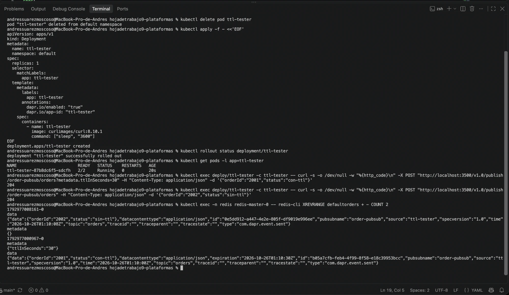

Al encender el subscriber, la app solo recibió el 2002 y `daprd` registró `dropping expired pub/sub event b05a7cfb-… as of 2026-10-26T01:10:30Z`.

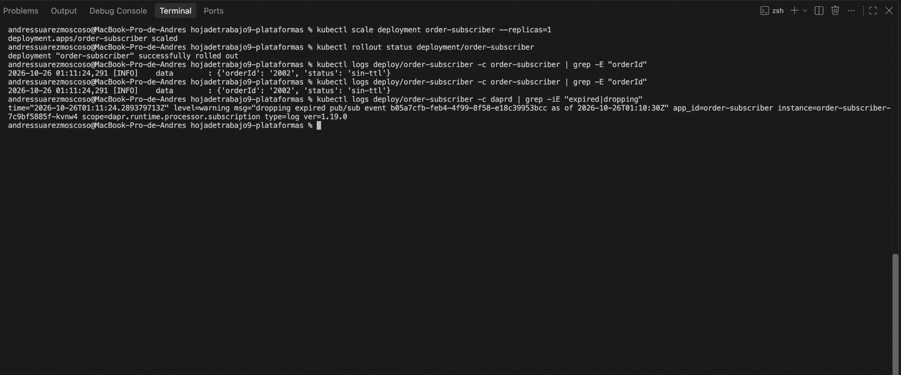
